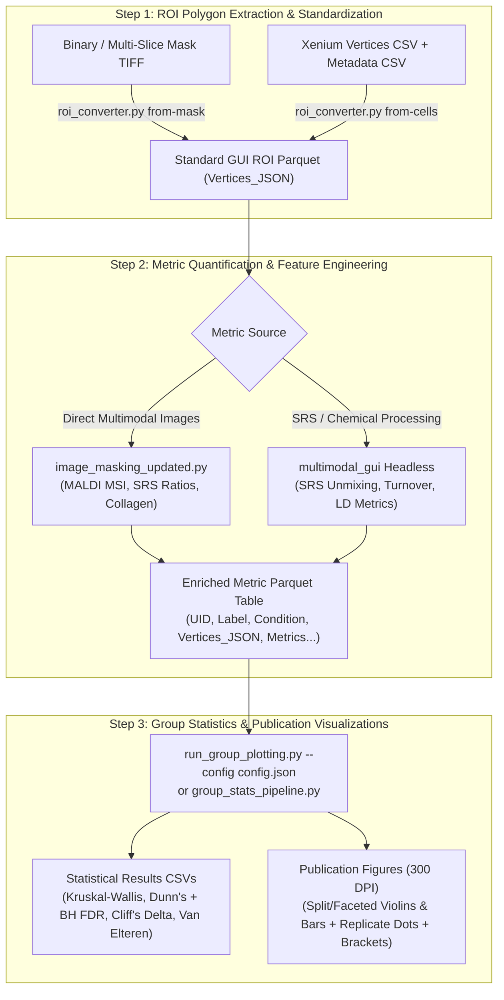

# Integrated Pipeline: ROI Extraction, Metric Quantification & Group Statistics Suite

This consolidated suite provides an end-to-end workflow for:
1. **Generating Standardized `Vertices_JSON` ROI Parquet tables** from binary/multi-slice segmentation masks (TIFF/OME-TIFF) or per-vertex single-cell tables (Xenium cell boundaries + metadata CSV).
2. **Quantifying Multi-Modal & Morphological Metrics** across ROIs (chemical ratios, MALDI mass spectrometry intensities, lipid droplet morphometrics, protein/lipid turnover, area/shape).
3. **Assessing Non-Parametric Group Statistics** (Kruskal-Wallis $H$, Dunn's post-hoc test + Benjamini-Hochberg FDR, Cliff's Delta $\delta$ effect size, and Van Elteren stratified Wilcoxon across biological replicates).
4. **Exporting Publication-Grade Visualizations** (Violin & Bar plots with sample-level strip dots and automated significance brackets).

---

## 📁 Consolidated Directory Structure

All necessary scripts and configuration files have been consolidated into `integrated_pipeline/`:

```text
integrated_pipeline/
├── __init__.py                       # Package initialization and public API exposure
├── README.md                         # This comprehensive guide
│
├── roi_converter.py                  # Step 1: Mask / Xenium CSV -> Vertices_JSON Parquet
├── image_masking_updated.py          # Step 1 & 2: Mask extraction + Multimodal quantification
│
├── group_stats_pipeline.py           # Step 3: Core statistics engine & publication plotter
├── calculate_group_statistics.py     # Step 3: Headless statistics determination suite (CSV outputs)
├── run_group_plotting.py             # Step 3: Config-driven CLI runner
├── filter_significant_pairs.py       # Step 3: Post-hoc filter to detect standout groups (>=80% pairs)
│
└── configs/                          # Config presets for reproducible runs
    ├── xenium_stats_config.json      # Xenium single-cell morphology / condition stats
    ├── vallon_stats_config.json      # SRS arithmetic / turnover / lipid unmixing stats
    ├── wsi_stats_config.json         # Whole-slide imaging / CODEX cluster stats
    └── kidney_*.json                 # Cluster & FTU annotation dictionaries
```

---

## 🧩 Workflow Overview



---

## 🛠️ Step 1: Creating `Vertices_JSON` Parquet Tables

Standard GUI-compatible ROI tables require a specific canonical schema used across `multimodal_gui` and downstream analysis:
- `UID`: Unique global identifier per instance (e.g. `Sample1_roi1_PT_12`)
- `Sample_ID`: Biological replicate or specimen ID
- `FOV_Number`: Sub-region / tile / field-of-view identifier (aliased as `ROI_Number`)
- `Label`: Cell type or anatomical compartment (`PT`, `TAL`, `Glomeruli`, etc.)
- `Vertices_JSON`: JSON-encoded 2D polygon vertex coordinates `[[x1, y1], [x2, y2], ..., [x1, y1]]` (closed loop)
- `Geometry_WKT`: Standard OGC Well-Known Text string (`POLYGON ((x1 y1, ...))`)
- `Centroid_X`, `Centroid_Y`: Center of mass coordinate (spatial moments)
- `Area_px`: Polygon pixel area (shoelace calculation)
- `pixel_size_um`, `Image_Width`, `Image_Height`: Spatial calibration metadata (extracted if image supplied)

### Option 1A: From Binary or Multi-Slice Segmentation Mask TIFF

Use `roi_converter.py from-mask`. It employs OpenCV C++ contour tracing (`approxPolyDP`) to extract thousands of closed polygons in seconds:

```bash
python integrated_pipeline/roi_converter.py from-mask \
    --mask "path/to/segmentation_mask.ome.tiff" \
    --output "path/to/extracted_rois.parquet" \
    --sample-id "Sample_01" \
    --fov-number "1" \
    --image "path/to/reference_canvas.tif" \
    --min-size 10 \
    --approx-eps 0.8 \
    --csv
```

**Parameters**:
- `--mask`: Path to binary (2D) or multi-slice/multi-label (3D/OME) mask TIFF.
- `--image`: Attached reference canvas image. Used to auto-extract pixel size ($\mu\text{m}$) and dimensions ($W, H$).
- `--min-size`: Exclude noise instances smaller than $N$ pixels (default: `10`).
- `--approx-eps`: Douglas-Peucker polygon approximation tolerance (default: `0.8` px).
- `--csv`: Also export a companion `.csv` file.

---

### Option 1B: From Raw Xenium Cell Segmentation & Metadata CSV

Raw Xenium single-cell data typically consists of per-vertex boundary tables (`cell_id`, `vertex_x`, `vertex_y`) and cell annotation metadata tables (`cell_id`, `levelKID_refined` / cell class).

Use `roi_converter.py from-cells` to perform single-step projection, merging, canvas cropping, and polygon assembly:

```bash
python integrated_pipeline/roi_converter.py from-cells \
    --vertices "path/to/cell_boundaries.csv.gz" \
    --metadata "path/to/cells_metadata.csv" \
    --output "path/to/xenium_gui_rois.parquet" \
    --sample-id "Xen_3990" \
    --fov-number "roi1" \
    --label-col "levelKID_refined" \
    --cell-col "cell_id" \
    --x-col "vertex_x" \
    --y-col "vertex_y" \
    --i2r "path/to/registration_matrix.i2r.json" \
    --image "path/to/target_srs_canvas.tif" \
    --csv
```

**Key Features**:
- Single-step streaming directly to GUI polygons (avoids slow 300,000+ line intermediate CSVs).
- Optional spatial affine registration matrix projection via `--i2r` (`.i2r.json`).
- Automatic bounding box intersection and vertical orientation matching.

---

## 🔬 Step 2: Calculating & Quantifying ROI Metrics

Before computing group statistics, numerical measurement features must be present in the table. These metrics fall into three categories:

### 1. Intrinsic Morphological Metrics (Automatic in Step 1)
- `Area_px`: Cell / ROI pixel area.
- `Area_um2`: Computed if `pixel_size_um` is present: $\text{Area\_px} \times (\text{pixel\_size\_um})^2$.
- `Centroid_X`, `Centroid_Y`: Positional spatial coordinates.

### 2. Multi-Modal Hyperspectral / MALDI / Ratio Quantification
Use `integrated_pipeline/image_masking_updated.py`:
- Extracts polygons and directly quantifies pixel intensities across raw multi-channel MALDI MSI (`.tiff` + `.i2r.json`), pre-registered hyperspectral Raman/SRS ratio images (Redox ratio, Lipid unsaturation ratio, Protein turnover), and collagen thickness maps.
- Supports scheduled multi-scale dilation (e.g. 2 px for intracellular lipids/metabolites, 10 px for extracellular collagen matrix).
- Outputs an enriched `.parquet` table containing `Vertices_JSON` and all calculated metric columns.

### 3. Headless SRS & Spectral Arithmetic Unmixing
Using `multimodal_gui` headless pipelines (or equivalent arithmetic scripts):
- Yields chemical concentration metrics: `% Sterols`, `% Cardiolipins`, `% Phospholipids`, `% Glycerols`, `% SFA`, `% PUFA`.
- Yields lipid droplet (LD) morphometrics: `LD Count`, `LD Total Area (um2)`, `LD Mean Area (um2)`, `LD Area Fraction (%)`.
- Yields turnover rates: `Protein_Turnover Mean`, `Lipid_Turnover Mean`, `Lipid_to_Protein Mean`.

---

## 📊 Step 3: Group Statistics & Publication Plotting

The analysis suite utilizes non-parametric statistics specifically tailored for biological microscopy and single-cell datasets with skewed distributions, large sample sizes ($N > 1,000$), and discrete biological replicates.

### Statistical Methodology

| Test / Metric | Purpose | Mathematical Basis |
| :--- | :--- | :--- |
| **Kruskal-Wallis $H$** | Omnibus test across $>2$ groups | Non-parametric rank sum test ($\eta^2_H$ omnibus effect size) |
| **Dunn's Post-Hoc** | All pairwise comparisons | Exact pooled rank variance with tied-rank correction |
| **Benjamini-Hochberg (BH)** | Multiplicity correction | False Discovery Rate control ($q < 0.05$) |
| **Cliff's Delta ($\delta$)** | Non-parametric effect size | Degree of overlap: $P(X > Y) - P(X < Y)$ with Romano (2006) 95% CIs |
| **Van Elteren Wilcoxon** | Replicate-stratified Wilcoxon | Tests differences while stratifying by biological replicate (`Sample_ID`) to prevent pseudoreplication |

---

### Method A: Config-Driven Execution (Recommended)

Edit or create a JSON configuration file in `integrated_pipeline/configs/`:

**Example `configs/xenium_stats_config.json`**:
```json
{
  "input_path": "path/to/extracted_rois.parquet",
  "output_dir": "path/to/output_plots_and_stats",
  "group_cols": ["Condition", "Label"],
  "sample_col": "Sample_ID",
  "lookup_table": {
    "source_col": "Sample_ID",
    "target_col": "Condition",
    "mapping": {
      "Ref_01": "Reference",
      "AKI_01": "AKI",
      "CKD_01": "CKD"
    }
  },
  "filter_values": {
    "Label": ["PT", "altPT", "TAL", "altTAL", "DCT", "EC", "POD"]
  },
  "value_cols": ["Area_px", "% Sterols", "% Phospholipids", "LD Count"],
  "plot_types": "both",
  "combine_two_groups": false,
  "ignore_zeros": true,
  "stats_mode": "nonparametric",
  "min_effect_size_bracket": 0.147
}
```

Run via CLI:
```bash
python integrated_pipeline/run_group_plotting.py --config integrated_pipeline/configs/xenium_stats_config.json
```

---

### Method B: Programmatic Python Execution

You can load your `.parquet` table directly in Python or Jupyter:

```python
import pandas as pd
from integrated_pipeline import run_group_stats_pipeline

# 1. Load Parquet table
df = pd.read_parquet("path/to/all_images_roi_metrics.parquet")

# 2. (Optional) Custom feature engineering
if "LD Total Area (um2)" in df.columns and "LD Count" in df.columns:
    df["LD Area / Count"] = df["LD Total Area (um2)"] / df["LD Count"]

# 3. Execute statistics and plotting pipeline
results = run_group_stats_pipeline(
    df=df,
    group_cols=["Condition", "Label"],          # Primary group + optional facet
    value_cols=["% Sterols", "LD Count", "Area_px"],
    sample_col="Sample_ID",                     # Biological replicate column for strip dots & Van Elteren test
    plot_types="both",                          # "violin", "bar", or "both"
    combine_two_groups=False,                   # False = facet by Label; True = combine "Condition | Label"
    output_dir="output_results/group_stats",
    add_brackets=True,                          # Automatic significance brackets
    min_effect_size_bracket=0.147,              # Only draw brackets if |Cliff's delta| >= 0.147
    stats_mode="nonparametric",
    palette=["#e85b1e", "#f19d78", "#37498b", "#a7b4e3"],
    font_scale=1.5,
    save_legend=True
)
```

---

### Method C: Headless Statistical Determination (CSV Only)

If you only need batch statistical CSV reports without rendering Matplotlib figures:

```bash
python integrated_pipeline/calculate_group_statistics.py \
    --input "path/to/all_images_roi_metrics.parquet" \
    --output-dir "path/to/stats_tables_only" \
    --groups Condition Label \
    --alpha 0.05 \
    --min-effect 0.147
```

---

### Method D: Discovering Standout Groups (`filter_significant_pairs.py`)

To find groups that are statistically higher or lower than $\ge 80\%$ of all other groups for each metric:

```bash
python integrated_pipeline/filter_significant_pairs.py \
    --input "output_results/group_stats/dunns_posthoc_fdr_cliffs_delta.csv" \
    --output "output_results/group_stats/standout_significant_groups.csv" \
    --majority-thresh 0.80 \
    --alpha 0.05
```

---

## 📈 Pipeline Outputs

When running the pipeline, statistical summary tables are generated in `output_dir`. You can configure the export format via `"export_format"` (`"parquet"`, `"csv"`, or `"both"`):

### 1. Statistical Report Tables (Parquet / CSV)
- **`descriptive_statistics_summary`**: Count, Median, Mean, IQR, Q25, Q75, MAD, Min, Max, Replicate count.
- **`kruskal_wallis_results`**: Omnibus Kruskal-Wallis $H$-statistic, degrees of freedom, $p$-value, and $\eta^2_H$ effect size.
- **`dunns_pairwise_fdr_cliffs_delta`**: Pairwise comparisons ($A$ vs $B$), Median($A$), Median($B$), Dunn's $Z$, raw $p$, BH-FDR adjusted $q$, Cliff's $\delta$, Romano 95% CI, and Effect magnitude.
- **`stratified_sample_wilcoxon`**: Van Elteren stratified Wilcoxon across biological replicates ($Z$, $p$, direction, biological concordance check).

### 2. Publication Visualizations (PNG at 300 DPI)
- **`*_violin_plot.png`**: Violin distribution with inner quartile/median boxes, embedded micro-observation strip points colored by biological replicate, and automated significance brackets.
- **`*_bar_plot.png`**: Bar chart of group medians $\pm$ IQR error bars (or mean $\pm$ SEM) with sample dots and brackets.
- **`sample_legend.png`**: Clean, standalone legend mapping biological replicate colors for multi-panel publication figures.

---

## 📋 Comprehensive File Reference

| File | Primary Role | Inputs | Outputs |
| :--- | :--- | :--- | :--- |
| [`roi_converter.py`](file:///c:/Users/jvill/Documents/GitHub/hsi_machine_learning/integrated_pipeline/roi_converter.py) | Converts masks or single-cell CSVs into GUI Parquet tables | 2D/3D TIFF mask or Xenium CSV boundaries + metadata | Standardized `.parquet` with `Vertices_JSON` |
| [`image_masking_updated.py`](file:///c:/Users/jvill/Documents/GitHub/hsi_machine_learning/integrated_pipeline/image_masking_updated.py) | High-speed multi-modal mask extraction & metric quantification | Mask TIFF + Multi-channel value TIFFs (MALDI, SRS ratios) | `.parquet` with `Vertices_JSON` and extracted metric columns |
| [`group_stats_pipeline.py`](file:///c:/Users/jvill/Documents/GitHub/hsi_machine_learning/integrated_pipeline/group_stats_pipeline.py) | Core statistical engine and publication visualization generator | Enriched metric `.parquet` / `.csv` | 300 DPI Violin/Bar plots + 4 statistical summary CSVs |
| [`run_group_plotting.py`](file:///c:/Users/jvill/Documents/GitHub/hsi_machine_learning/integrated_pipeline/run_group_plotting.py) | Config-driven execution entrypoint | JSON configuration file | Automated pipeline execution & plot saving |
| [`calculate_group_statistics.py`](file:///c:/Users/jvill/Documents/GitHub/hsi_machine_learning/integrated_pipeline/calculate_group_statistics.py) | Headless batch statistics calculator | Metric table (`.parquet` / `.csv`) | CSV statistical summary tables |
| [`filter_significant_pairs.py`](file:///c:/Users/jvill/Documents/GitHub/hsi_machine_learning/integrated_pipeline/filter_significant_pairs.py) | Filters standout biological conditions | Post-hoc results CSV | Filtered summary of standout groups ($\ge 80\%$) |
| [`core/nonparametric_stats.py`](file:///c:/Users/jvill/Documents/GitHub/hsi_machine_learning/core/nonparametric_stats.py) | Vectorized mathematical implementation | NumPy arrays / Pandas series | $H$, Dunn $Z$, $q_{\text{BH}}$, $\delta$, Van Elteren $Z$ |
| [`integrated_pipeline/configs/`](file:///c:/Users/jvill/Documents/GitHub/hsi_machine_learning/integrated_pipeline/configs) | Presets for Xenium, SRS arithmetic, and WSI | JSON configuration templates | Input parameters for `run_group_plotting.py` |
